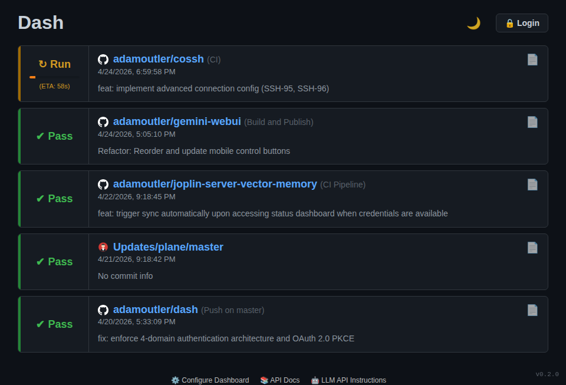
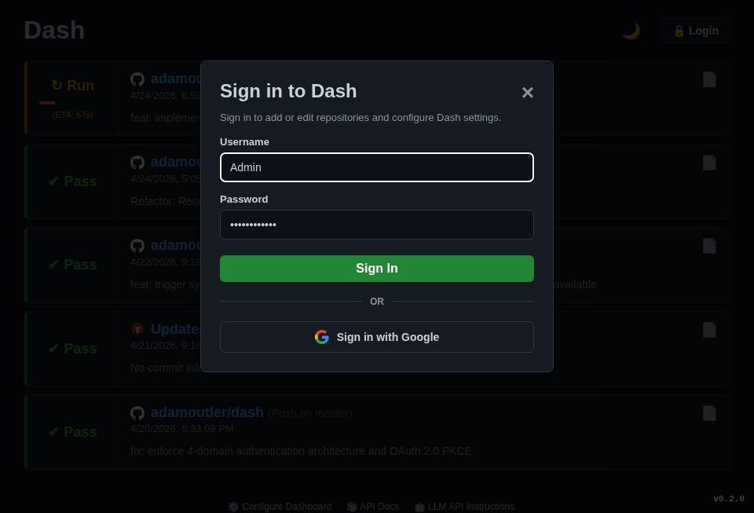
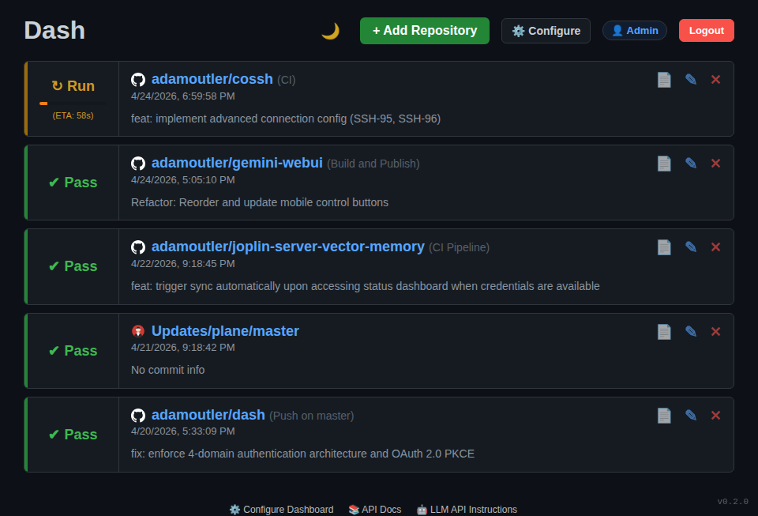
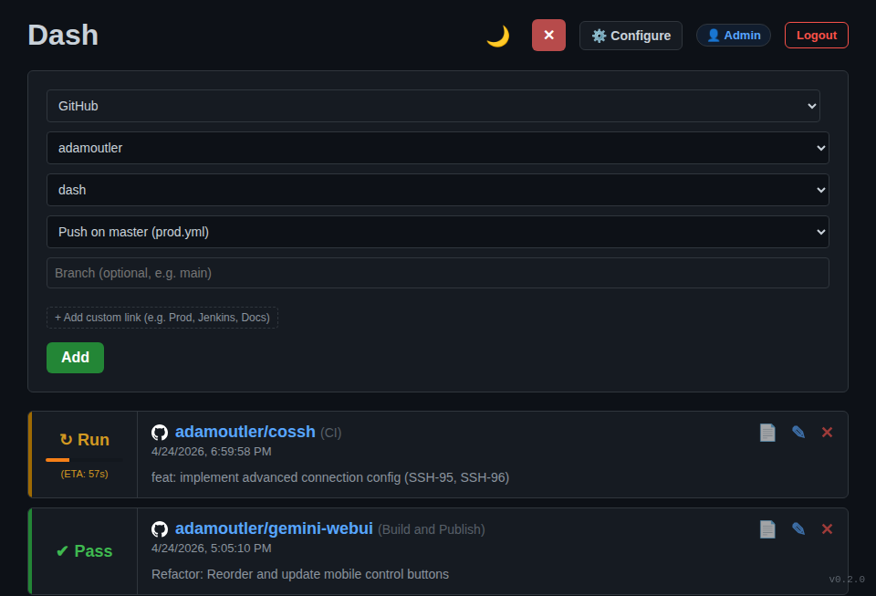
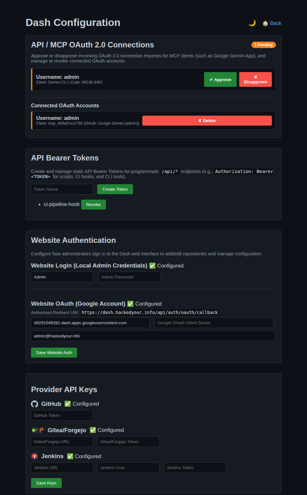

# Dash User Manual

Dash is a CI/CD status monitoring dashboard designed to provide an at-a-glance overview of your repository builds and test runs from GitHub, Forgejo/Gitea, and Jenkins. It provides a responsive visual interface for humans and a hardened REST API and Model Context Protocol (MCP) server for autonomous AI agents.

## 1. Public Read-Only Dashboard

By default, visiting the root dashboard (`/`) provides a **public read-only view** without forcing a browser authentication popup. Anyone on your team can immediately check build health and inspect logs while mutating controls remain hidden.

From the public read-only view, you can:
- View real-time statuses of recent workflow runs (`Pass`, `Fail`, `Run` with live ETA progress bars).
- Click direct links to workflow runs, repositories, or custom quick-action links.
- Inspect raw build logs using the **📄** button.
- Toggle Light / Dark / Auto theme using the theme button (`☀️` / `🌙` / `🌗`).

## 2. Website Login & Google OAuth (Domains 3 & 4)

To add or edit repositories or change system settings, click **🔒 Login** in the top-right header (or click **⚙️ Configure Dashboard** in the footer).

Dash supports two human administrator login methods:
- **Website Login (Domain 3)**: Sign in with your configured administrator username and password (`DASHBOARD_USER` / `DASHBOARD_PASSWORD`), establishing an `HttpOnly` signed session cookie with CSRF protection.
- **Website OAuth (Domain 4)**: Click **Sign in with Google** when Google OIDC is configured (`GOOGLE_CLIENT_ID`, `GOOGLE_CLIENT_SECRET`, and `GOOGLE_ALLOWED_EMAILS`). Only verified Google accounts matching your explicit email allowlist are permitted.

## 3. Authenticated Admin Dashboard

Once authenticated, the dashboard unlocks all management controls in-place:

Authenticated administrators can:
- Verify their active session via the `👤 admin` user badge.
- Open **+ Add Repository** to track new projects or **⚙️ Configure** to manage credentials and tokens.
- Use **✎ Edit** and **✕ Remove** on individual repository cards.
- Sign out cleanly at any time via **Logout**.

## 4. Adding & Editing Repositories

Click **+ Add Repository** on the authenticated home page to open the cascading repository selector:

1. Select your CI Provider (**GitHub**, **Gitea/Forgejo**, or **Jenkins**).
2. Browse or enter the repository owner/organization, repository/job path, and specific workflow.
3. Optionally specify a target branch (e.g., `main`) and custom quick-action links.
4. Click **Save Repository** to begin tracking.

## 5. 4-Domain Security & Configuration Console (`/configure`)

Click **⚙️ Configure** in the header (or **⚙️ Configure Dashboard** in the footer) to open the administrative configuration console:

### API / MCP OAuth 2.0 Connections (Domain 2: `mcp_oauth`)
- When an MCP client (such as Google Gemini App, Gemini CLI, or Claude) connects to `/mcp`, Dash challenges it with RFC 9728 Protected Resource Metadata and guides the user through an OAuth 2.0 + PKCE (`S256`) flow at `/oauth/authorize`.
- Incoming requests appear live in **API / MCP OAuth 2.0 Connections** (and as a real-time toast notification on any dashboard page) showing the requester's username and verification code (`DASH-XXXX-XXXX`).
- Click **✔ Approve** to grant an MCP-scoped OAuth token (`domain="mcp_oauth"`) or **✘ Disapprove** to deny access. Active sessions can be revoked at any time under **Connected MCP OAuth Sessions**.

### API Bearer Tokens (Domain 1: `api_token`)
- Generate long-lived Bearer tokens under **API Bearer Tokens (Domain 1)** for CLI scripts, CI hooks, and `curl` commands calling `/api/*`.
- Raw tokens are displayed only once upon creation and are stored as SHA-256 hashes on disk (masked as `tok_...` in the UI). Domain 1 API tokens are strictly isolated from `/mcp`.

### Website Authentication (Domains 3 & 4)
- Configure or update the local administrator username/password (**Domain 3**) and Google OAuth 2.0 Client ID, Client Secret, and comma-separated Allowed Emails (**Domain 4**).

### Provider API Keys
1. **GitHub**: Enter a Personal Access Token with read access to Actions/workflows.
2. **Gitea/Forgejo**: Enter your instance URL and access token.
3. **Jenkins**: Enter your Jenkins URL, username, and API token.
4. Click **Save Keys**.

## 6. AI & LLM Automation (MCP & REST API)

Dash provides both a native MCP server (`/mcp`, authenticated via **Domain 2 MCP OAuth 2.0 + PKCE**) and a REST API (`/api/*`, authenticated via **Domain 1 API Bearer Tokens**).

### MCP Server Tools (`/mcp`)
- `get_status(repo, workflow, provider, branch)`: Fetch the latest status of a tracked repository.
- `get_logs(repo, workflow, provider, branch)`: Retrieve the log URL and tail of the latest build log.
- `get_branches(repo, provider)`: List branches for a repository.
- `wait(repo, workflow, provider, branch)`: Long-poll and wait for an active build to finish to save tokens.

### REST API Examples (`/api/*`)
- **Get All Statuses**: `curl -s https://dash.hackedyour.info/api/status`
- **Wait for Build**: `curl -N -s -H "Authorization: Bearer $DASH_TOKEN" "https://dash.hackedyour.info/api/wait?provider=github&owner=adamoutler&repo=gemini-webui"`

For complete agent instructions, point your LLM to `<dash-url>/llms.txt`.
